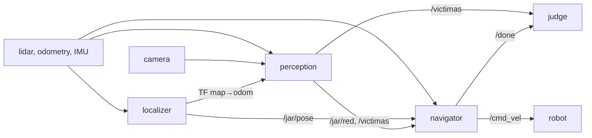

<div align="center">

# 🛟 fierro-rescue-robot

**Search-and-rescue software for a ROS 2 mobile robot, with its own localization, planning and control.**

It receives the map of a maze, localizes itself, sweeps it looking for red boxes (the victims), reports
where they are, drives back to the start and signals that it is done. It does not use Nav2 or AMCL.
Built by **Team Fierro** for the **Challenge JAR 2026**.

[](https://github.com/BarralMaximo/fierro-rescue-robot/actions/workflows/ci.yml)
[](https://barralmaximo.github.io/fierro-rescue-robot/)
[](https://docs.ros.org/en/humble/)
[](https://www.python.org/)
[](LICENSE)

[Demo](#-demo) ·
[Features](#-features) ·
[Results](#-results) ·
[How it works](#-how-it-works) ·
[Project layout](#-project-layout) ·
[CI/CD](#%EF%B8%8F-cicd) ·
[Quick start](#-quick-start) ·
[Team](#-team-fierro)

</div>

---

> [!NOTE]
> **Competition origin.** Written for the [**Challenge JAR 2026**](https://airclub-udesa.github.io/jar_site/reglamento/),
> organized by the [**AIR Club UdeSA**](https://github.com/AIRclub-UdeSA) at the Jornada Argentina de Robótica.
> It runs on a **Yahboom ROSMASTER X3** (mecanum wheels, 2D lidar, camera, IMU) with ROS 2 Humble and Python.
> The full development history, commit by commit, lives in the [submission fork](https://github.com/marijanicki/jar_challenge_fierro).

---

## 🎬 Demo

<p align="center">
  <a href="https://barralmaximo.github.io/fierro-rescue-robot/"></a>
</p>
<p align="center">
  <a href="https://barralmaximo.github.io/fierro-rescue-robot/"><b>Open the interactive demo</b></a>
  <br>
  <sub>A simulated mission run with the code in this repo: it finds the 3 victims, ignores the 2 decoys and is back at the start in 76 s.
  CI regenerates the interactive demo on every push.</sub>
</p>

---

## ✨ Features

| | |
|---|---|
| 📍 **Custom localization** | A particle filter fed by wheel odometry, gyroscope and lidar. It relocalizes on its own when it gets lost. |
| 🎯 **Camera + lidar fusion** | The camera says what is red and the lidar says where it is. Reports landed at a 4.8 cm median error in Gazebo and at 10 cm or less on the real robot. |
| 🗺️ **Planned sweep** | With a known map there is nothing to explore: it picks where to look from (greedy coverage) and in what order (nearest neighbor + 2-opt). |
| 🛡️ **Chassis protection** | A control barrier, solved as a quadratic program (QP), changes the command as little as possible so the robot's tail never touches anything. |
| 🧪 **Tested without a simulator** | 207 test cases, including the whole mission in a kinematic simulation. |
| ⚙️ **CI/CD** | Lint, tests inside ROS 2 Humble with Docker, the demo published on GitHub Pages and releases with the image on GHCR. |

---

## 🏁 Results

This code ran the qualifying round on November 4, 2026, on the real robot and in an arena we had never seen.

| | Simulator (Gazebo, 11 worlds × 2) | Real robot (qualifying) |
|:--|:--|:--|
| Victims found | 55 of 58 | 4 of 4 |
| Report error | 4.8 cm median | 3.6 to 10 cm |
| Back at the start | 22 of 22 runs | yes, `/done` at 370 s |
| Collisions | 0 crashes, 8 scrapes of 0–2 cm | **15** |
| Score | 94.4 % of the maximum | **0** (400 + 100 − 750; the total cannot go below 0) |

Finding and locating the boxes worked on the track just as it did in the simulator. Avoiding obstacles did not: every
collision costs 50 points, and 15 of them wiped out everything else. They were side and tail scrapes. Looking back at the
run, we found two things the simulator did not have:

- **About 0.4 s of latency**, because the software runs on a laptop that talks to the robot over Wi-Fi.
- **Weaker motors than commanded**: they delivered 88 % of the requested forward speed and 67 % of the requested turn rate.

The corner of the tail ended up touching wall tips. We then tried more conservative parameters against the collisions and
the second run went worse, so this repo keeps the parameters from the first one.

<p align="center">
  
</p>
<p align="center"><sub>
  A simulator run with this code. The blue line is the path, the stars are the victims and the dots are the reports.
  It found all 3 and returned to the start: 600 points, the maximum for this map.
</sub></p>

---

## 🧠 How it works

There are three nodes. At the start, all three receive the map on `/map`; the robot does not move before that.



### 1. Localizing (`localizer`)

A custom particle filter with 500 particles and 90 lidar rays per scan.

- **Prediction.** Forward motion comes from the wheels and rotation from the gyroscope. If the IMU drops out or turns the
  opposite way from the wheels, rotation also comes from the wheels.
- **Correction.** Each particle is scored by how close its rays land to a wall, using a distance field computed once when the map arrives.
- **Start.** The judges place the robot by hand near the origin, so the first pose comes from a brute-force search over
  ±0.4 m and a full turn, coarse first and then fine.
- **Relocalization.** If several scans in a row fit poorly, it repeats that search around the last pose. It only accepts
  the result if it fits clearly better; otherwise what changed is the world (an object not on the map), not the pose.

### 2. Finding the boxes (`perception`)

The camera says what is red and the lidar says where it is.

1. Build a red mask in HSV. The thresholds were chosen from real photos taken by the robot, with altered lighting.
2. Project every lidar ray onto the image. Rays that land on red pixels give the distance to the box.
3. Filter the parallax between camera and lidar: erode the silhouette and cut rays where the distance jumps.
4. Add half a box to go from the face the lidar sees to the center, which is what the judge measures.
5. Group detections by box and take the median. A box is reported only with enough rays over several scans and little
   spread, because each report spends one of the N available.

On a recording from the real robot with added noise (67 passes), there were no false reports.

### 3. Sweeping and returning (`navigator`)

- **Sweep.** Since the map is known, there is nothing to explore: it is enough to choose where to look from. When `/map`
  arrives, it computes the waypoints once (greedy coverage) and their order (nearest neighbor + 2-opt).
- **The lidar searches, the camera confirms.** Anything outside the map's walls with a box shape (RANSAC, one face or two
  in an L) is a candidate. With mecanum wheels, where the robot goes and where it faces are independent, so it points
  the camera at the candidate without stopping.
- **Paths.** Dijkstra over the grid, with a cost that grows near walls so it drives down the middle of the corridor, and
  pure pursuit to follow the path.
- **Protection.** The brake models the chassis as a circle, which does not cover the tail. That is what `tail_barrier`
  is for: a QP that changes the command as little as possible so the chassis rectangle does not get close to what the lidar sees behind it.
- **Return.** It heads back once it has reported the N victims, has seen everything or is running out of time, and
  publishes `/done` within 15 cm of the start.

---

## 📁 Project layout

```text
fierro-rescue-robot/
├── fierro/
│   ├── core.py         # map, particle filter, sweep planning, detection grouping
│   ├── detector.py     # red in the image + lidar → box centers
│   ├── mission.py      # the mission: paths, candidates, protection and return
│   ├── localizer.py    # node: robot pose and TF map→odom
│   ├── perception.py   # node: detects the boxes and reports them on /victimas
│   ├── navigator.py    # node: runs the mission, publishes /cmd_vel and /done
│   └── ros_utils.py    # shared by the nodes: QoS, parameters, timing, IMU
├── launch/fierro.launch.py   # starts the three nodes
├── params/params.yaml        # every parameter, with comments
├── test/                     # tests that need no simulator
├── docs/                     # the demo (demo.py generates the run, index.html draws it)
├── Dockerfile                # ROS 2 Humble with the package built
└── .github/workflows/        # CI, demo and release
```

`core.py`, `detector.py` and `mission.py` do not depend on ROS: the nodes only wire that logic to the topics. That is
why the tests can run the whole mission in a kinematic simulation, without Gazebo, and why the demo runs in CI with just NumPy and SciPy.

---

## ⚙️ CI/CD

| Workflow | When | What it does |
|:--|:--|:--|
| [CI](.github/workflows/ci.yml) | push to `main` and PRs | Lint with ruff, the tests inside the ROS 2 Humble image, and a check that the launch file starts and waits for the map. |
| [Demo](.github/workflows/pages.yml) | push to `main` | Runs a simulated mission with the commit's code and publishes it on [GitHub Pages](https://barralmaximo.github.io/fierro-rescue-robot/). |
| [Release](.github/workflows/release.yml) | tag `v*` | Runs CI and, if it passes, publishes the image to `ghcr.io` and creates the release from the tag message. |

The same Docker image is used for testing and for running, and it starts from the same base image as the Challenge's CI.
Actions are pinned by SHA. To cut a release, bump `<version>` in `package.xml` and `setup.py` and push an annotated tag;
its message becomes the release notes:

```bash
git tag -a v1.1.0 -m "Fierro 1.1.0" -m "What changed." && git push origin v1.1.0
```

The [`jar2026-clasificacion`](https://github.com/BarralMaximo/fierro-rescue-robot/tree/jar2026-clasificacion) tag marks
the qualifying code exactly as it entered this repo. The commits after it clean up the code, the docs and CI without
changing the logic or the parameters.

---

## 🚀 Quick start

### With Docker (no ROS install)

```bash
# Tests
docker run --rm ghcr.io/barralmaximo/fierro-rescue-robot python3 -m pytest -q src/fierro/test
# Mission
docker run --rm --net=host ghcr.io/barralmaximo/fierro-rescue-robot ros2 launch fierro fierro.launch.py victims:=3
```

The mission needs the robot or the simulator on the same network. `docker build -t fierro .` builds the image from the repo.

### With ROS 2 Humble

From your workspace folder:

```bash
git clone https://github.com/BarralMaximo/fierro-rescue-robot src/fierro
colcon build --packages-select fierro
source install/setup.bash
python3 -m pytest src/fierro/test     # tests, no simulator needed
```

### A full run in the simulator

You need the [simulator](https://github.com/AIRclub-UdeSA/yahboom_rosmaster) (tag `jar2026-v1`) and the practice judge,
`tools/juez.py` from the [Challenge template](https://github.com/AIRclub-UdeSA/jar_challenge), which publishes the map
and computes the score. In three terminals, in this order:

```bash
# 1. The simulator
SIM=$(ros2 pkg prefix --share yahboom_rosmaster_gazebo)
ros2 launch yahboom_rosmaster_gazebo rosmaster_gazebo_fortress.launch.py \
  world:=$SIM/worlds/maze_3_6x6_victimas.world

# 2. Fierro (victims:=N is how many victims to look for)
ros2 launch fierro fierro.launch.py use_sim_time:=true victims:=3

# 3. The judge, from the template
SIM=$(ros2 pkg prefix --share yahboom_rosmaster_gazebo)
python3 tools/juez.py --mundo maze_3_6x6 --mapa $SIM/maps/maze_3_6x6.yaml \
  --ground-truth --esperar-topic /scan --retardo 5 --duracion 300
```

### The demo

Open `docs/index.html` directly, no server needed. To regenerate it after changing the code, with plain Python and no ROS:

```bash
pip install numpy scipy pyyaml pytest
python3 docs/demo.py
pytest      # tests the logic and skips what needs ROS
```

---

## 👥 Team Fierro

| | |
|:--|:--|
| **Máximo Barral** | [@BarralMaximo](https://github.com/BarralMaximo) |
| **María Paz Janicki** | [@marijanicki](https://github.com/marijanicki) |

The project starts from the [Challenge template](https://github.com/AIRclub-UdeSA/jar_challenge) by the AIR Club UdeSA.

---

## 📄 License

Released under the [MIT License](LICENSE). © 2026 AIR Club UdeSA and Team Fierro.
