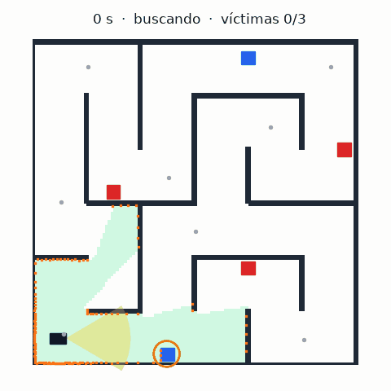
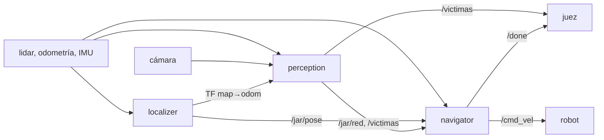

# Fierro

[](https://github.com/BarralMaximo/fierro-rescue-robot/actions/workflows/ci.yml)
[](https://barralmaximo.github.io/fierro-rescue-robot/)
[](https://docs.ros.org/en/humble/)
[](https://www.python.org/)
[](LICENSE)

Software de búsqueda y rescate para un robot móvil con ROS 2. Recibe el mapa de un laberinto, se ubica, lo recorre buscando cajas rojas (las víctimas), reporta dónde están, vuelve a la largada y avisa que terminó.

Lo hicimos para el [Challenge JAR 2026](https://airclub-udesa.github.io/jar_site/reglamento/), organizado por el [AIR Club UdeSA](https://github.com/AIRclub-UdeSA) en la Jornada Argentina de Robótica. Corre en un Yahboom ROSMASTER X3 (ruedas mecanum, lidar 2D, cámara, IMU) con ROS 2 Humble y Python. La localización, la planificación y el control son propios: no usa Nav2 ni AMCL.

<p align="center">
  <a href="https://barralmaximo.github.io/fierro-rescue-robot/"></a>
  <br>
  <a href="https://barralmaximo.github.io/fierro-rescue-robot/"><b>Ver la demo interactiva</b></a>
  <br>
  <sub>Una misión simulada con el código del repo: encuentra las 3 víctimas, descarta los 2 señuelos y vuelve a la largada en 76 s. La demo interactiva la regenera el CI en cada push.</sub>
</p>

## En resumen

- **Localización propia.** Filtro de partículas con odometría, giróscopo y lidar, que se relocaliza solo si se pierde.
- **Cámara + lidar.** La cámara dice qué es rojo y el lidar dice dónde está: los reportes quedaron a 4.8 cm de mediana en Gazebo y a 10 cm o menos en el robot real.
- **Recorrido planeado.** Con el mapa conocido no hace falta explorar: elige desde dónde mirar (cobertura golosa) y en qué orden (vecino más cercano y 2-opt).
- **Protección del chasis.** Una barrera de control, resuelta como un problema de optimización (QP), corrige el comando lo mínimo para que la cola no toque nada.
- **Probado sin simulador.** 207 casos de prueba, incluida la misión entera en una simulación cinemática.
- **CI/CD.** Lint, tests dentro de ROS 2 Humble con Docker, la demo publicada en GitHub Pages y releases con la imagen en GHCR.

## Resultado

Con este código corrimos la clasificación del 4 de noviembre de 2026, en el robot real y en una arena que no conocíamos. El desarrollo completo, commit a commit, está en el [fork de entrega](https://github.com/marijanicki/jar_challenge_fierro).

| | Simulador (Gazebo, 11 mundos × 2) | Robot real (clasificación) |
|---|---|---|
| Víctimas encontradas | 55 de 58 | 4 de 4 |
| Error de los reportes | mediana 4.8 cm | de 3.6 a 10 cm |
| Regreso a la largada | 22 de 22 corridas | sí, `/done` a los 370 s |
| Colisiones | 0 choques, 8 roces de 0 a 2 cm | **15** |
| Puntaje | 94.4 % de lo posible | **0** (400 + 100 − 750; el total no baja de 0) |

Encontrar y ubicar las cajas funcionó en la pista igual que en el simulador. Esquivar, no: cada colisión descuenta 50 puntos y las 15 borraron todo lo demás. Fueron roces de costado y de cola. En el análisis posterior vimos dos cosas que el simulador no tenía: unos 0.4 s de retardo, porque el software corre en una laptop que le habla al robot por wifi, y motores que daban el 88 % del avance y el 67 % del giro pedidos. La esquina de la cola llegó a tocar puntas de pared.

Después probamos parámetros más conservadores contra los choques y la segunda corrida salió peor, así que acá quedan los de la primera.


*Una corrida en el simulador con este código. La línea azul es el recorrido, las estrellas son las víctimas y los puntos, los reportes. Encontró las 3 y volvió a la largada: 600 puntos, el máximo de este mapa.*

## Cómo funciona

Son tres nodos. Al largar, los tres reciben el mapa en `/map`; antes de eso el robot no se mueve.



### Ubicarse (`localizer`)

Es un filtro de partículas propio, con 500 partículas y 90 rayos del lidar por scan.

- **Predicción.** El avance sale de las ruedas y el giro del giróscopo. Si la IMU se cae o gira al revés que las ruedas, el giro también sale de las ruedas.
- **Corrección.** Cada partícula se puntúa por qué tan cerca de una pared caen los rayos, con un campo de distancias calculado una sola vez al llegar el mapa.
- **Largada.** Los jueces ponen el robot a mano cerca del origen, así que la primera pose sale de una búsqueda por fuerza bruta: ±0.4 m y la vuelta entera, primero gruesa y después fina.
- **Relocalización.** Si varios scans seguidos calzan mal, repite esa búsqueda cerca de la última pose. Solo la acepta si calza claramente mejor; si no, lo que cambió es el mundo (un objeto que no está en el mapa), no la pose.

### Encontrar las cajas (`perception`)

La cámara dice qué es rojo y el lidar dice dónde está.

1. Arma una máscara del rojo en HSV. Los umbrales se eligieron con fotos reales del robot, alterando la luz.
2. Proyecta cada rayo del lidar sobre la foto. Los que caen en píxeles rojos dan la distancia a la caja.
3. Filtra el paralaje entre cámara y lidar: erosiona la silueta y corta los rayos donde la distancia salta.
4. Agrega media caja para pasar de la cara que ve el lidar al centro, que es lo que mide el juez.
5. Agrupa las detecciones por caja y toma la mediana. Reporta solo con suficientes rayos en varios scans y poca dispersión, porque cada reporte gasta uno de los N disponibles.

Sobre una grabación del robot real con ruido agregado (67 pasadas) no hubo ningún reporte falso.

### Recorrer y volver (`navigator`)

- **Recorrido.** Como el mapa se conoce, no hace falta explorar: alcanza con elegir desde dónde mirar. Al llegar `/map` calcula una sola vez los puntos de paso (cobertura golosa) y su orden (vecino más cercano y 2-opt).
- **El lidar busca y la cámara confirma.** Lo que aparece fuera de las paredes del mapa con forma de caja (RANSAC, una cara o dos en L) es un candidato. Con ruedas mecanum, hacia dónde va y hacia dónde mira son independientes: el robot apunta la cámara al candidato sin dejar de avanzar.
- **Caminos.** Dijkstra sobre la grilla, con un costo que crece cerca de las paredes para ir por el medio del pasillo, y pure pursuit para seguirlo.
- **Protección.** El freno modela el chasis como un círculo, que no cubre la cola. Para eso está `tail_barrier`, un problema de optimización (QP) que cambia el comando lo menos posible para que el rectángulo del chasis no se acerque a lo que ve el lidar detrás.
- **Regreso.** Vuelve cuando reportó las N víctimas, cuando ya vio todo o cuando se le acaba el tiempo, y publica `/done` a menos de 15 cm de la largada.

## Código

```text
fierro/
├── core.py         mapa, filtro de partículas, recorrido y agrupado de detecciones
├── detector.py     rojo en la imagen + lidar → centros de caja
├── mission.py      la misión: caminos, candidatos, protección y regreso
├── localizer.py    nodo: pose del robot y TF map→odom
├── perception.py   nodo: detecta las cajas y las reporta en /victimas
├── navigator.py    nodo: corre la misión y publica /cmd_vel y /done
└── ros_utils.py    lo que comparten los nodos: QoS, parámetros, tiempos e IMU
launch/fierro.launch.py     levanta los tres nodos
params/params.yaml          todos los parámetros, comentados
test/                       pruebas sin simulador
docs/                       la demo (demo.py genera la corrida, index.html la dibuja)
Dockerfile                  ROS 2 Humble con el paquete compilado
.github/workflows/          CI, demo y release
```

`core.py`, `detector.py` y `mission.py` no dependen de ROS: los nodos solo conectan esa lógica con los topics. Por eso los tests pueden probar la misión entera en una simulación cinemática, sin Gazebo, y la demo corre en el CI con numpy y scipy.

## CI/CD

| Workflow | Cuándo | Qué hace |
|---|---|---|
| [CI](.github/workflows/ci.yml) | push a `main` y PR | Lint con ruff, los tests dentro de la imagen de ROS 2 Humble y que el launch arranque y espere el mapa. |
| [Demo](.github/workflows/pages.yml) | push a `main` | Corre una misión simulada con el código del commit y la publica en [GitHub Pages](https://barralmaximo.github.io/fierro-rescue-robot/). |
| [Release](.github/workflows/release.yml) | tag `v*` | Corre el CI y, si pasa, publica la imagen en `ghcr.io` y crea el release con el mensaje del tag. |

La misma imagen de Docker sirve para testear y para correr, y parte de la misma imagen base que el CI del Challenge. Las actions están fijadas por SHA. Para sacar una versión se sube `<version>` en `package.xml` y `setup.py` y se pushea un tag anotado; su mensaje es el texto del release:

```bash
git tag -a v1.1.0 -m "Fierro 1.1.0" -m "Qué cambió." && git push origin v1.1.0
```

El tag [`jar2026-clasificacion`](https://github.com/BarralMaximo/fierro-rescue-robot/tree/jar2026-clasificacion) marca el código de la clasificación tal como entró a este repo; los commits que siguen ordenan el código, la documentación y el CI sin cambiar la lógica ni los parámetros.

## Cómo correrlo

**Con Docker**, sin instalar ROS:

```bash
# Tests
docker run --rm ghcr.io/barralmaximo/fierro-rescue-robot python3 -m pytest -q src/fierro/test
# Misión
docker run --rm --net=host ghcr.io/barralmaximo/fierro-rescue-robot ros2 launch fierro fierro.launch.py victims:=3
```

La misión necesita el robot o el simulador en la misma red. `docker build -t fierro .` arma la imagen desde el repo.

**Con ROS 2 Humble**, desde la carpeta de tu workspace:

```bash
git clone https://github.com/BarralMaximo/fierro-rescue-robot src/fierro
colcon build --packages-select fierro
source install/setup.bash
python3 -m pytest src/fierro/test     # pruebas, sin simulador
```

Para una corrida completa hacen falta el [simulador](https://github.com/AIRclub-UdeSA/yahboom_rosmaster) (tag `jar2026-v1`) y el juez de práctica, `tools/juez.py` del [template del Challenge](https://github.com/AIRclub-UdeSA/jar_challenge), que publica el mapa y da el puntaje. En tres terminales, en este orden:

```bash
# 1. El simulador
SIM=$(ros2 pkg prefix --share yahboom_rosmaster_gazebo)
ros2 launch yahboom_rosmaster_gazebo rosmaster_gazebo_fortress.launch.py \
  world:=$SIM/worlds/maze_3_6x6_victimas.world

# 2. Fierro (victims:=N es la cantidad a buscar)
ros2 launch fierro fierro.launch.py use_sim_time:=true victims:=3

# 3. El juez, desde el template
SIM=$(ros2 pkg prefix --share yahboom_rosmaster_gazebo)
python3 tools/juez.py --mundo maze_3_6x6 --mapa $SIM/maps/maze_3_6x6.yaml \
  --ground-truth --esperar-topic /scan --retardo 5 --duracion 300
```

**La demo** se abre directo: `docs/index.html`, sin servidor. Para regenerarla después de cambiar el código, con Python y sin ROS: `pip install numpy scipy pyyaml pytest` y `python3 docs/demo.py`. Con eso también anda `pytest`: prueba la lógica y saltea lo que necesita ROS.

## Créditos

Equipo Fierro: [Máximo Barral](https://github.com/BarralMaximo) y [marijanicki](https://github.com/marijanicki).

El proyecto parte del [template del Challenge](https://github.com/AIRclub-UdeSA/jar_challenge) del AIR Club UdeSA.

## Licencia

[MIT](LICENSE).
